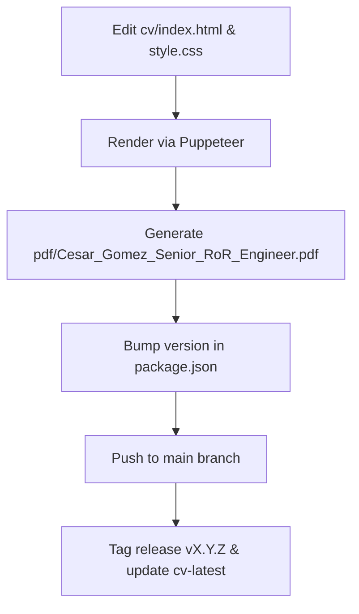

# AGENTS.md

> [!NOTE]
> This repository generates the Curriculum Vitae (CV) for Cesar Gomez in Portable Document Format (PDF). GitHub Actions builds the PDF and publishes it to releases.

## Architecture and Repository Structure

The repository maintains two synchronized representations of the CV alongside automated build tooling.



| Path | Purpose |
| --- | --- |
| `cv/index.html` | Semantic HTML source for the styled CV layout. |
| `cv/style.css` | Print styles, variables, typography, and page margins. |
| `cv/render.js` | Puppeteer script running headless Chromium to generate the PDF. |
| `README.md` | Plain Markdown version of the resume for GitHub readers. |
| `package.json` | Project dependencies and semantic version metadata. |
| `Dockerfile` | Debian Bookworm image with Node 26 and Chromium dependencies. |
| `docker-compose.yml` | Container definition mounting `cv/` and `pdf/` directories. |
| `.github/workflows/html_to_pdf.yml` | Continuous Integration and Continuous Deployment (CI/CD) release pipeline. |

## Build and Generation Workflows

Choose one of two methods to render the PDF locally.

### Method 1: Docker Compose

Docker isolates all Chromium dependencies and guarantees consistent rendering across platforms.

1. Start the container build and render process:
   ```bash
   docker compose up --build
   ```
2. Check the output file at `pdf/Cesar_Gomez_Senior_RoR_Engineer.pdf`.

> [!TIP]
> Use Docker Compose when local Chromium libraries or font packages fail to load.

### Method 2: Local Node.js Environment

Use local Node.js when system dependencies for Chromium already exist on the host.

1. Install project dependencies:
   ```bash
   npm install
   ```
2. Ensure the output directory exists:
   ```bash
   mkdir -p pdf
   ```
3. Execute the render script:
   ```bash
   node cv/render.js
   ```

> [!WARNING]
> Puppeteer fails with `ENOENT` if the `pdf` directory does not exist prior to rendering.

> [!TIP]
> If Puppeteer cannot launch its bundled Chrome, set `PUPPETEER_EXECUTABLE_PATH` to a system Chrome or use Docker Compose.

## Content Synchronization Rules

Updates to resume content MUST follow these maintenance rules:

- Authors MUST update `README.md` and `cv/index.html` together when changing professional history, dates, or skills.
- The `README.md` file MUST remain formatted as standard Markdown.
- Visual tweaks MUST reside in `cv/style.css` using existing CSS custom properties.
- Layout modifications MUST respect A4 pagination to prevent awkward page splits or orphaned headings.
- Authors MUST treat the Docker Compose render as the reference. Host fonts differ and can hide layout defects.
- Right-aligned text MUST stay inside `--print-edge-gap`. Without it, Chrome clips the last character of each date.
- Authors MUST confirm the PDF has exactly two pages after every content change, with the current role alone on page 1.
- Authors MUST bump `version` in `package.json` and create matching git tags for releases.

## 2026 CV Standards and Content Quality Rules

> [!NOTE]
> Modern Applicant Tracking Systems (ATS) and hiring teams evaluate senior engineers through semantic machine parsing and six-second human reviews.

### Document Architecture and Page Budget

- The CV MUST maintain a strict two-page budget for A4 format.
- Page 1 MUST hold the header, summary, technical skills, education, and the current lead role.
- Page 2 MUST hold earlier senior engineering roles without trailing overflow.
- Page breaks MUST occur only between job blocks or subjobs using `break-inside: avoid`.
- Authors MUST NOT split a single bullet point or isolate a heading across page boundaries.

### Impact-Driven Bullet Formulation (XYZ Standard)

- Every experience bullet MUST follow Google's XYZ formula: Accomplished [X], measured by [Y], by doing [Z].
- At least 70% of bullets MUST contain quantifiable metrics like throughput, latency, cost, coverage, or time savings.
- Every bullet MUST begin with a strong past-tense action verb (for example: architected, scaled, automated, optimized).
- Bullets MUST run two lines or fewer in rendered print.
- Sentences MUST NOT exceed 25 words.

### ATS and AI Screening Optimization

- Headings MUST use standard terminology: `Professional Summary`, `Technical Skills`, `Professional Experience`, `Education`.
- Technical skills MUST appear as plain, comma-separated text grouped by technical domain.
- Authors MUST NOT use progress bars, star ratings, or arbitrary percentage ratings.
- Contact information MUST include email, location (City, Country), remote status, LinkedIn URL, and GitHub URL.
- Exclude street addresses, photographs, marital status, birth dates, and references.

### Senior Technical Positioning and Recency Weighting

- Allocate 60% of experience content to achievements from the last four years.
- Emphasize system architecture, reliability, throughput, and organizational leverage.
- Highlight modern engineering practices, including distributed event streaming, CI/CD automation, and developer tooling.
- Roles older than seven years SHOULD feature only two or three bullets focusing on foundational architecture or scale.

### Prohibited Patterns and Content Anti-Patterns

| Pattern Type | Avoid | 2026 Replacement |
| --- | --- | --- |
| Task descriptions | "Responsible for building APIs" | "Designed REST APIs serving 20k requests/min" |
| Subjective claims | "Hard-working team player" | Omit entirely; demonstrate collaboration via mentorship bullets |
| Punctuation | Em dashes and unicode arrows | Commas, hyphens, colons, or `->` |
| Skill metrics | "Ruby on Rails: 95%" | "Ruby on Rails (13 yrs)" or production scope context |
| Legacy listings | Long lists of deprecated tools | Current production tech stack and foundational tools |

## CI/CD and Release Pipeline

The release pipeline pairs explicit semantic version tags with a rolling latest release.

### Semantic Versioning Rules

- The repository follows Semantic Versioning (`vMAJOR.MINOR.PATCH`).
- Increment MAJOR for full layout overhauls or profile pivots.
- Increment MINOR for new career roles or new major sections.
- Increment PATCH for bullet edits, typos, or style adjustments.
- Release tags MUST begin with the `v` prefix (for example: `v1.0.0`).

### Release Procedure

1. Verify layout and pagination locally.
2. Update the `version` property in `package.json`.
3. Commit all changes to the `main` branch.
4. Create the semantic version tag:
   ```bash
   git tag vX.Y.Z
   ```
5. Move the rolling latest tag:
   ```bash
   git tag -f cv-latest
   ```
6. Push commits and tags to GitHub:
   ```bash
   git push origin main
   git push origin vX.Y.Z
   git push origin cv-latest --force
   ```
7. Verify that GitHub Actions finishes successfully.

## Agent Guidelines and Operational Rules

Agents working in this codebase MUST follow these operational boundaries:

- Never use em dashes or unicode arrows. Use commas, hyphens, colons, or `->`.
- Keep sentences to 25 words or fewer.
- Never delete files without explicit confirmation from the user.
- Never add `Co-authored-by` trailers to git commit messages.
- Always prefer modern CLI tools:
  - `rg` instead of `grep`
  - `fd` instead of `find`
  - `eza` instead of `ls`
  - `sd` instead of `sed`
  - `jq` instead of manual JSON parsing
