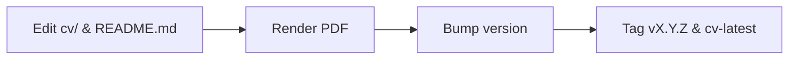

# AGENTS.md

> [!NOTE]
> This repository builds and publishes Cesar Gomez's Curriculum Vitae (CV) as an A4 PDF using Puppeteer and GitHub Actions, synchronized with README.md.

## Repository Structure



| Path | Purpose |
| --- | --- |
| `cv/index.html` | Semantic HTML source for CV layout. |
| `cv/style.css` | Print styles, variables, typography, and page margins. |
| `cv/render.js` | Puppeteer script running headless Chromium to generate PDF. |
| `README.md` | Plain Markdown version for GitHub readers. |
| `package.json` | Project dependencies and semantic version metadata. |
| `Dockerfile` | Debian Bookworm container with Node 26 and Chromium. |
| `docker-compose.yml` | Container definition mounting `cv/` and `pdf/`. |
| `.github/workflows/html_to_pdf.yml` | CI/CD build and release pipeline. |

## Build Workflows

Reference output: `pdf/Cesar_Gomez_Senior_RoR_Engineer.pdf`.

- **Docker Compose (Reference)**: Use for guaranteed font and layout parity.
  ```bash
  docker compose up --build
  ```
- **Local Node.js**: Fast local rendering when Chromium dependencies exist.
  ```bash
  npm install && mkdir -p pdf && node cv/render.js
  ```

> [!WARNING]
> Puppeteer fails with `ENOENT` if `pdf/` does not exist before running `cv/render.js`.

## Synchronization and Pagination Rules

- Authors MUST update `README.md` and `cv/index.html` together for history, dates, or skills changes.
- Visual tweaks MUST reside in `cv/style.css` using existing CSS variables.
- Right-aligned text MUST remain inside `--print-edge-gap` to prevent date clipping in Chrome.
- The rendered PDF MUST strictly span two A4 pages, verified against the Docker build.
- Page 1 MUST hold header, summary, technical skills, education, and the current lead role.
- Page 2 MUST hold earlier senior roles without trailing overflow.
- Page breaks MUST only occur between job blocks using `break-inside: avoid`.
- Authors MUST NOT split a bullet point or orphan a heading across pages.

## Content and Quality Standards

- **Formula**: Every bullet MUST use XYZ format (Accomplished [X], measured by [Y], by doing [Z]).
- **Metrics**: At least 70% of bullets MUST contain quantifiable numbers (throughput, latency, cost, time).
- **Verbs**: Bullets MUST start with strong past-tense action verbs. Max 2 rendered lines and <= 25 words per sentence.
- **ATS Headings**: MUST use `Professional Summary`, `Technical Skills`, `Professional Experience`, `Education`.
- **Skills**: Comma-separated text grouped by domain. Do NOT use progress bars or ratings.
- **Recency**: 60% of content MUST focus on the last 4 years. Roles older than 7 years SHOULD use only 2-3 bullets.
- **Contact Info**: MUST include email, location (City, Country), remote status, LinkedIn, and GitHub. Exclude photo, address, and references.

| Pattern | Avoid | 2026 Replacement |
| --- | --- | --- |
| Tasks | "Responsible for building APIs" | "Designed REST APIs serving 20k req/min" |
| Subjective | "Hard-working team player" | Omit; demonstrate via mentorship bullets |
| Punctuation | Em dashes and unicode arrows | Commas, hyphens, colons, or `->` |
| Skill metrics | "Ruby on Rails: 95%" | "Ruby on Rails (13 yrs)" or production scope |
| Deprecated | Long lists of legacy tools | Current production stack and core tools |

## Release Pipeline

Follow Semantic Versioning: increment MAJOR for overhauls, MINOR for new roles/sections, PATCH for bullet edits/fixes.

1. Verify layout and pagination locally in Docker.
2. Bump `version` in `package.json`.
3. Commit to `main` branch.
4. Tag and push release:
   ```bash
   git tag vX.Y.Z
   git tag -f cv-latest
   git push origin main vX.Y.Z
   git push origin cv-latest --force
   ```

## Agent Operational Rules

- Never use em dashes or unicode arrows; use commas, colons, or `->`.
- Keep sentences to 25 words or fewer.
- Never delete files without explicit confirmation.
- Never add `Co-authored-by` lines to commit messages.
- Always prefer modern CLI tools: `rg`, `fd`, `eza`, `sd`, `jq`.
